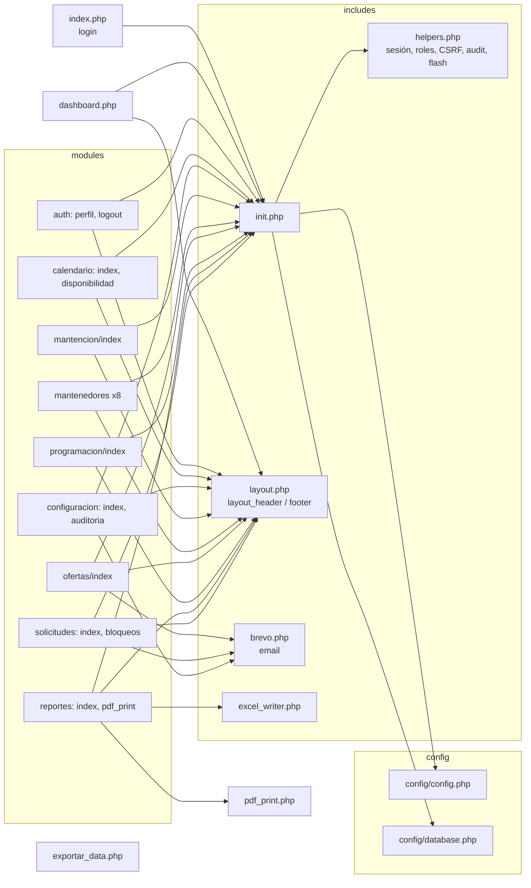
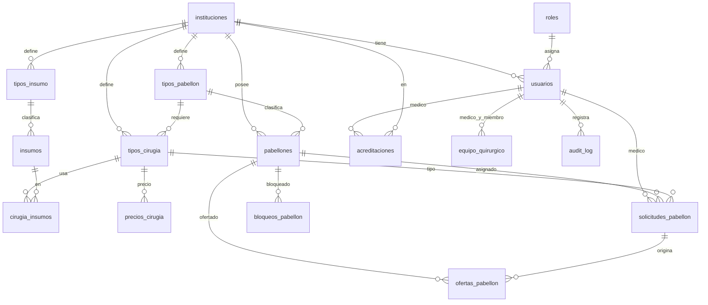

# Grafo del repositorio: sistema-pabellones

Aplicación PHP (sin framework) para gestión de pabellones quirúrgicos: solicitudes, ofertas, programación, calendario, mantención y reportes. 44 archivos, ~9.800 líneas.

## 1. Dependencias de archivos

Nota: las flechas a `brevo.php` y `excel_writer.php` son aproximadas (hay 3 requires de brevo y 1 de excel_writer); verifique el módulo exacto con `grep -rn brevo modules`.

## 2. Modelo de datos (database.sql)

## 3. Nodos más centrales

| Nodo | Rol |
|---|---|
| `includes/init.php` | Punto de entrada común, cargado por todas las páginas |
| `includes/layout.php` | Plantilla UI compartida por todos los módulos |
| `includes/helpers.php` | Autenticación por rol, CSRF, auditoría, formato |
| `instituciones` (tabla) | Raíz multi-tenant: casi todas las tablas la referencian |
| `solicitudes_pabellon` | Entidad de negocio central (conecta médico, pabellón, cirugía, ofertas) |

## 4. Archivos más grandes (candidatos a refactor)

`ofertas/index.php` (786), `calendario/index.php` (770), `solicitudes/index.php` (711), `programacion/index.php` (686), `mantencion/index.php` (537).

## 5. Scripts SQL de migración

`migracion_periodos`, `migracion_mantencion`, `migracion_precio_oferta`, `migracion_precios_pabellon`, `migracion_config_email`, más dos de limpieza (`limpiar_ofertas_canceladas`, `limpiar_solicitudes_invalidas`). Son parches sobre `database.sql`.
